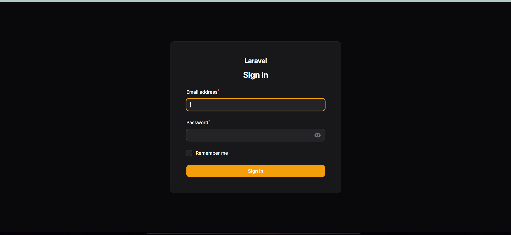
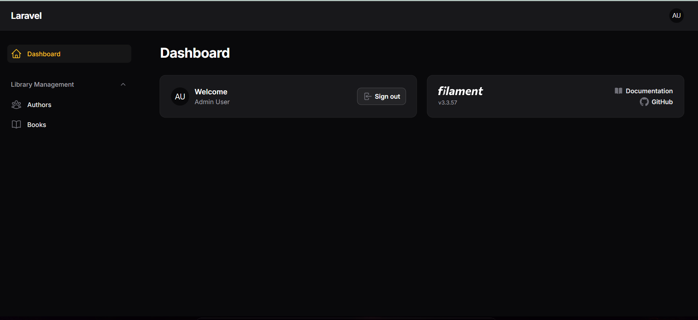
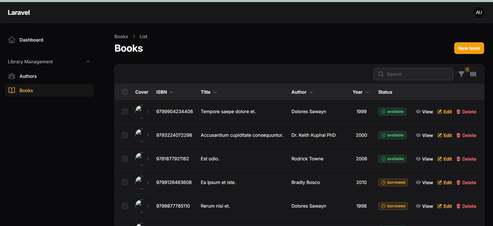
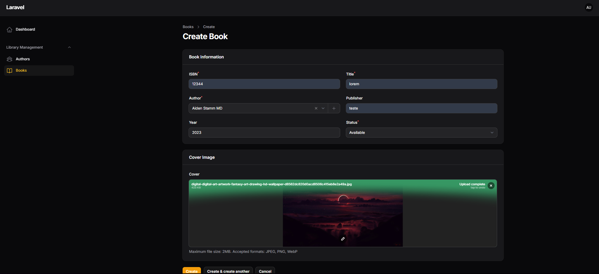
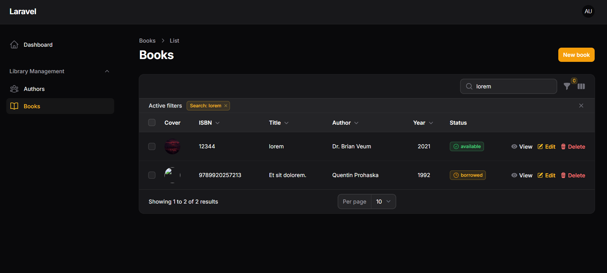
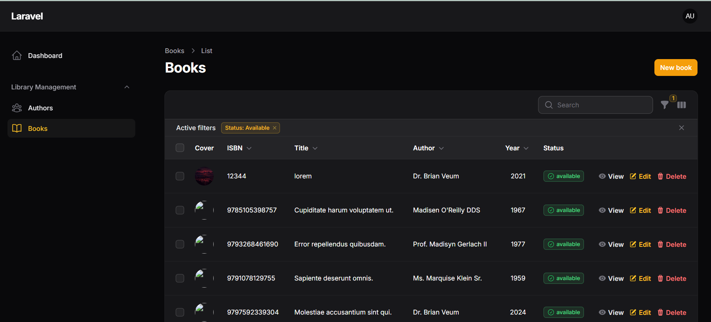
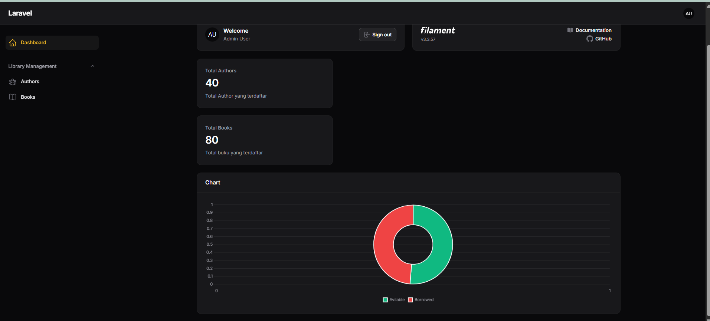
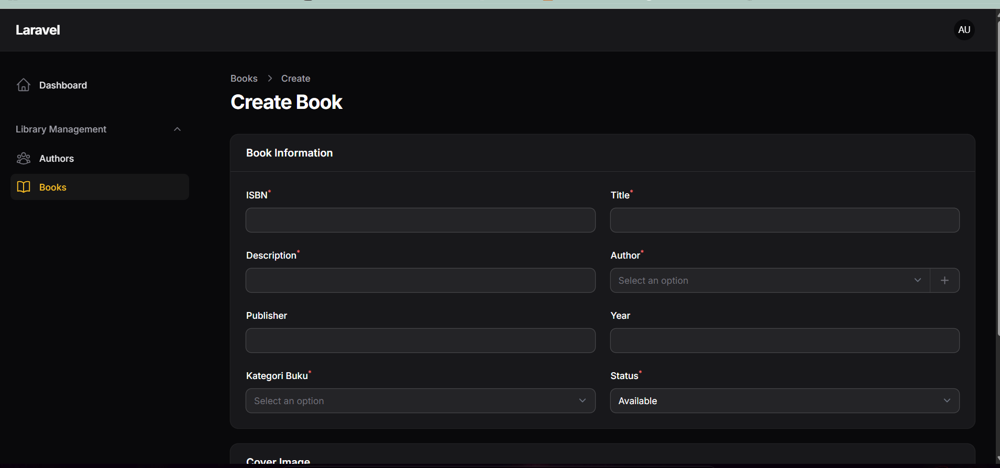
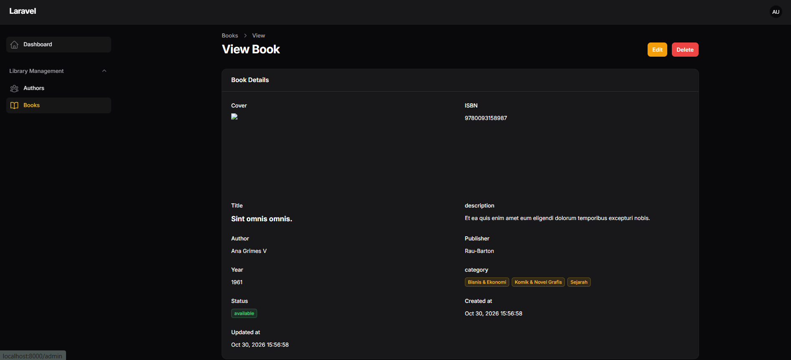

# Laporan Tugas Pertemuan 5 Prak Pemorgraman Berbasis Web
Disusun Oleh:
<br>
<table>
    <tbody>
        <tr>
            <td>
                Nama:
            </td>
            <td>
                Muhamad Edvin Hidayat
            </td>
        </tr>
        <tr>
           <td>
                NPM:
            </td>
            <td>
                4524210054
            </td>
        </tr>
        <tr>
            <td>
                Kelas:
            </td>
            <td>
                Prak PBW A
            </td>
        </tr>
    </tbody>
</table>

# Authbook - Aplikasi Pengelolaan Buku
<b>Authbook</b> Merupakan aplikasi berbasis web yang dikembangkan untuk mempermudah proses pengelolaan koleksi buku dan informasi penulis. Proyek ini menggunakan arsitektur Laravel 12 sebagai framework utaman dan Filament 3.x untuk membangun panel administrasi yang praktis dan mudah digunakan.

# Daftar Isi
1. <a href="https://github.com/edvinHdyt/prak-pbw-a-muhamad-edvin-hidayat-2454/edit/main/Pert5/authbook#fitur-aplikasi"> Fitur Aplikasi </a>

# Fitur Aplikasi
1. Halaman Autentikasi (Login dan Register)
2. Panel admin
3. Pengelolaan Data buku
4. Pengelolaan Data Penulis
5. Database Seeder

# Teknologi yang Digunakan
<table>
    <thead>
        <th>Teknologi</th>
        <th>Kegunaan</th>
    </thead>
    <tbody>
        <tr>
            <td>
                PHP 8.3+
            </td>
            <td>
                Dasar bahasa pemrograman Laavel
            </td>
        </tr>
        <tr>
           <td>
                Laravel 12
            </td>
            <td>
                Framework pengembangan website
            </td>
        </tr>
        <tr>
            <td>
                Filament 3.x
            </td>
            <td>
                Framewok panel admin
            </td>
        </tr>
        <tr>
            <td>
                Mysql
            </td>
            <td>
                Basis Data
            </td>
        </tr>
         <tr>
            <td>
                Composer
            </td>
            <td>
                Manajemen dependensi PHP
            </td>
        </tr>
         <tr>
            <td>
                Git dan Github
            </td>
            <td>
                Pengelolaan pengembangan kode
            </td>
        </tr>
         <tr>
            <td>
                Laragon
            </td>
            <td>
                Lingkungan server Mysql
            </td>
        </tr>
    </tbody>
</table>

# Instalasi Proyek
1. Pengunduhan Soruce Code<br>
Pengunduhan source code dengan cara cloning melalui repositori github
```bash
git clone https://github.com/edvinHdyt/prak-pbw-a-muhamad-edvin-hidayat-2454.git
cd authbook
```
2. Instal Dependensi<br>
Penginstalan dependensi dilakukan agar Laravel dapat berjalan
```bash
composer install
```
3. Menyiapkan File Environment<br>
Copy file .env dari .env.exemple
```bash
copy .env.example .env
```
Selanjutnya, konfiguasi ulang file .env pada bagian bagian berikut:
```bash
APP_NAME=Authbook
APP_URL=http://127.0.0.1:8000

DB_CONNECTION=mysql
DB_HOST=127.0.0.1
DB_PORT=3306
DB_DATABASE=authbook
DB_USERNAME={sesuaikan usernama database anda}
DB_PASSWORD=
```
Pastikan mysql pada largon/xampp telah berjalan.

4. Membuat Application Key<br>
Perintah berikut digunakan untuk membuat kunci aplikasi pada laravel
```bash
php artisan key:generate
```

5. Migrasi Database <br>
Jalankan migrasi dan seeder untuk membuat table dan memasukan data dummy pada database.
```
php atisan migrate:fresh --seed
```
<b>Perhatian</b>: Perintah migrasi ini akan menghapus keseluruhan data yang telah ada pada database.

6. Mengaktifkan Penyimpanan File-File static<br>
File file static (seperti gambar) dipelukan dalam website ini, jadi agar file-file tersebut dapat terbaca guanakan perintah berikut
```
php artisan stoage:link
```
7. Pembuatan User dengan Filament<br>
Filament memungkinkan untuk membuat pengguna yang telah siap pakai, untuk melakukannya jalankan perintah berikut
```
php artisan make:filament-user
```
Ikuti instruksi pada terminal untuk memasukan nama, email, dan kata sandi (kata sandi tidak akan terlihat jadi pastikan memasukannya dengan baik)
8. Menjalankan Server <br>
Agar aplikasi dapat berjalan pada webiste, diperlukan web sever untuk menjalankannya.
```
php artisan serve
```
Masukan alamat berikut pada browser:
- Halaman admin: http://127.0.0.1:8000/admin
- Halaman Login: http://127.0.0.1:8000/admin/login

# Informasi Akun Pengguna
Selain akun yang telah dibuat secara filament sebelumnya, terdapat akun pengguna yang telah dibuat dengan menggunakan seeder. Berikut adalah akunnya.
<table>
<thead>
    <th>Keterangan</th>
    <th>Informasi</th>
</thead>
<tbody>
    <tr>
    <td>Email</td>
    <td>admin@example.com</td>
    <tr>
    <tr>
    <td>Password</td>
    <td>password</td>
    </tr>
 </tbody>
 </table>  

# Hasil Output
1. Halaman Login <br>

2. Halaman Dashboard Admin<br>

3. Halaman Kelola Buku<br>

4. Halaman Tambah Buku<br>

5. Fitur Pencaian Buku <br>

6. Fitur Filte buku <br>


# Update Webiste
## Versi 2.0.0
1. Penambahan role
Terdapat role yang menentukan fitur apa yang dapat diakses oleh setiap pengguna, role-role tersebut antara lain:
<table>
<thead>
    <th>Role</th>
    <th>Keterangan</th>
</thead>
<tbody>
    <tr>
    <td>Admin</td>
    <td>Akses terhadap seluruh fitur</td>
    <tr>
    <tr>
    <td>Staff</td>
    <td>Dapat mengelola (create dan update) pada data-data, namun tidak bisa mendelete data</td>
    </tr>
    <tr>
    <td>User View</td>
    <td>Hanya dpat melihat data</td>
    </tr>
 </tbody>
 </table>  
Berikut beberapa akun yang telah disiapkan beserta role-rolenya
<table>
<thead>
    <th>Keterangan</th>
    <th>Informasi</th>
</thead>
<tbody>
    <tr>
    <td>Email</td>
    <td>admin@example.com</td>
    <tr>
    <tr>
    <td>Password</td>
    <td>password</td>
    </tr>
    <tr>
    <td>Email</td>
    <td>staff@example.com</td>
    <tr>
    <tr>
    <td>Password</td>
    <td>password</td>
    </tr>
    <tr>
    <td>Email</td>
    <td>user-view@example.com</td>
    <tr>
    <tr>
    <td>Password</td>
    <td>password</td>
    </tr>
 </tbody>
 </table>

2. Perubahan tampilkan dashboard<br>
Terdapat perubahan pada tampilan dashboard dimana terdapat penambahan widget akumulasi total data buku dan penulis. Selain itu ada terdapat juga penambahan grafik untuk dapat melihat data status buku.

3. Penambahan kategori dan deskripsi pada buku<br>
Terdapat penambahan tabel baru yaitu categories, tabel ini berfungsi agar setiap buku mempunyai kategorinya masing-masing. Selain itu terdapat juga penambahan kolom deskripsi pada buku untuk menjelaskan buku-buku tersebut.

## Output Versi 2.0.0
1. Perubahan tampilan dashboard

2. Penambahan Kategori dan Deskripsi Buku


